# ELEVÉ CLOTHING STORE
## A Full-Stack Luxury Apparel & Streetwear E-Commerce Web Application
### User Driven Project (UDP) Report — Lok Jagruti Kendra University (LJKU)

---

**Institute:** Department of Computer Applications, LJ Institute of Computer Applications (LJICA), LJ University, Ahmedabad  
**Degree:** Master of Computer Applications (Integrated) — MCA (Integrated), 2024–2028  
**Faculty Guide:** Dr. Anjum Y. Mansuri, Assistant Professor, Computer Applications (GitHub: `@anjum-mansuri`)  
**Project Team:**
1. **Harsh Agechaniya** (Roll: E-01) — Documentation Lead & Quality Assurance Engineer
2. **Mit Dodiya** (Roll: E-10) — Backend Developer & Database Architect
3. **Jaimisha Chunara** (Roll: H-11) — Frontend Developer & UI/UX Designer  
**Repository:** [https://github.com/jaimisha15/Eleve-clothing-ecommerce](https://github.com/jaimisha15/Eleve-clothing-ecommerce)  
**Merchandising Boundary:** Curated exclusively across Men, Women, and Kids (29 verified apparel garments; footwear completely purged).

---

## TABLE OF CONTENTS
1. [Introduction](#1-introduction)
   - 1.1 Project Overview & Purpose
   - 1.2 Problem Statement
   - 1.3 Project Scope & Deliverables
   - 1.4 Hardware Requirements
   - 1.5 Software Requirements
   - 1.6 Project Profile
   - 1.7 Assumptions and Constraints
   - 1.8 Advantages and Limitations
2. [Project Planning](#2-project-planning)
   - 2.1 Team Details and Roles
   - 2.2 Proposed Timeline & Implementation Schedule (Gantt Chart)
3. [Requirement Determination & Analysis](#3-requirement-determination--analysis)
   - 3.1 Requirement Determination Methodology
   - 3.2 Functional Requirements (FR-01 to FR-07)
   - 3.3 Non-Functional Requirements (NFR-01 to NFR-04)
   - 3.4 Targeted Users & Roles
4. [System Design](#4-system-design)
   - 4.1 System Architecture Diagram (High-Resolution 3-Tier Architecture)
   - 4.2 Use Case Diagram & Actor Descriptions
   - 4.3 Class Diagram & Domain Entities
   - 4.4 Interaction / Sequence Diagram
   - 4.5 Activity Diagram (Order Placement Pipeline)
   - 4.6 Comprehensive Data Dictionary (14 Relational Tables)
5. [Development & Implementation](#5-development--implementation)
   - 5.1 Development Approach (Agile Methodology)
   - 5.2 Coding Standards & Architectural Best Practices
   - 5.3 GitHub Repository Details & Version Control Structure
   - 5.4 AI Tools, Libraries and APIs Used
   - 5.5 Implementation Walkthrough & Live System Screenshots (15 Modules)
6. [Proposed Enhancements](#6-proposed-enhancements)
7. [Conclusion](#7-conclusion)
8. [Bibliography & References](#8-bibliography--references)

---

# 1. INTRODUCTION
ELEVÉ is an enterprise-grade, responsive full-stack e-commerce web application engineered specifically for contemporary luxury apparel and high-fashion streetwear. Built using semantic HTML5, modern CSS3, modular Vanilla JavaScript (ES6+), and a secure PHP 8.x PDO backend interfacing with a MySQL relational database, the platform delivers a premium, uninterrupted digital shopping experience across three curated apparel collections: Men, Women, and Kids (with all footwear completely purged).

### 1.1 Project Overview & Purpose
In the competitive digital fashion industry, e-commerce stores often fail to engage consumers due to cluttered user interfaces, sluggish catalog browsing, mismatched product data, and generic checkout experiences. ELEVÉ addresses these challenges by merging an haute-couture aesthetic—inspired by luxury European fashion houses—with modern engineering practices. The purpose of this project is to create an authentic, full-featured retail platform that operates reliably in local development sandbox environments (such as XAMPP Apache/MySQL) while upholding strict data integrity standards through 3rd Normal Form relational schemas and parameterized prepared queries.

### 1.2 Problem Statement
Modern apparel retailers confront significant operational hurdles when transitioning to online commerce platforms:
- **Category Clutter:** Existing off-the-shelf templates frequently bundle conflicting merchandise categories (such as athletic footwear mixed into bespoke streetwear), confusing shoppers and compromising brand prestige.
- **Performance Bottlenecks:** Heavy monolithic JavaScript frameworks often impose large script payloads that degrade performance on low-bandwidth mobile connections.
- **Security Vulnerabilities:** Many educational projects use vulnerable PHP scripts susceptible to SQL injection and unhandled guest order references.
- **Fragmented Back-Office Tools:** Administrators frequently lack dedicated tools to monitor real-time revenue, manage category taxonomies, and track order fulfillment states.

### 1.3 Project Scope & Deliverables
- **Merchandising Focus:** Curated merchandise strictly limited to Men's, Women's, and Kids' clothing (29 total verified items). Footwear has been completely removed across database tables, product categories, and UI components.
- **Storefront Experience:** A client-side presentation layer offering dynamic department filtering, a live keyword search overlay, interactive size swatches, and slide-out cart and wishlist drawers.
- **Transaction Handling:** A resilient two-step checkout pipeline supporting Cash on Delivery (COD), UPI (GPay/PhonePe), Credit/Debit Card, and Net Banking.
- **Administrative Operations:** An administrative control center at `admin/` displaying revenue metrics, sales trends, product management, category configuration, and order lifecycle tools.

### 1.4 Hardware Requirements
| Component | Minimum Requirement | Recommended Specification |
|---|---|---|
| Processor (CPU) | Intel Core i3 / AMD Ryzen 3 (2.0 GHz) | Intel Core i5 / AMD Ryzen 5 (3.0 GHz) quad-core |
| System Memory (RAM) | 4 GB DDR4 | 8 GB to 16 GB DDR4 |
| Storage Space | 1 GB available disk space | 5 GB free SSD storage |
| Display Resolution | 1280 × 720 (HD) minimum | 1920 × 1080 (Full HD) |
| Input Devices | Standard keyboard & two-button mouse | Precision trackpad or multi-touch display |

### 1.5 Software Requirements
| Software Layer | Minimum Requirement | Recommended Specification |
|---|---|---|
| Operating System | Windows 10 / 11 (64-bit) | Windows 11 Pro / Ubuntu Linux 22.04 LTS |
| Web Server Stack | XAMPP v3.3.0 (Apache 2.4, PHP 8.2) | XAMPP 8.2.12 with Apache HTTP Server 2.4 |
| Database Engine | MySQL 8.0 / MariaDB 10.4 | MySQL Community Server 8.0 (InnoDB) |
| Backend Runtime | PHP 8.0+ with `pdo_mysql` | PHP 8.2+ with JSON, PDO, cURL, mbstring |
| Web Browsers | Google Chrome 110+, Firefox 110+ | Chrome latest, Microsoft Edge latest |
| Developer Tools | VS Code, Git 2.40+, phpMyAdmin | VS Code, Antigravity Agent, Postman |

### 1.6 Project Profile
| Attribute | Specification Details |
|---|---|
| Project Title | ELEVÉ Clothing Store (Luxury Apparel & Streetwear Web Application) |
| Academic Course | Master of Computer Applications (Integrated) — MCA (Integrated) |
| Academic Institution | Lok Jagruti Kendra University (LJKU), Ahmedabad, Gujarat |
| Department | Department of Computer Applications, LJ Institute of Computer Applications (LJICA) |
| Project Type | User Driven Project (UDP) / Full-Stack Web Application |
| Faculty Guide | Dr. Anjum Y. Mansuri, Assistant Professor, Computer Applications (GitHub: `@anjum-mansuri`) |
| Team Members | Harsh Agechaniya (E-01), Mit Dodiya (E-10), Jaimisha Chunara (H-11) |
| Source Code Repository | https://github.com/jaimisha15/Eleve-clothing-ecommerce |
| Target Localhost URL | `http://localhost/FINALUDPFOLDER/` or `http://localhost:8000/` |

---

# 2. PROJECT PLANNING

### 2.1 Team Details and Roles
| Student Name | Roll No | Assigned Role | Key Responsibilities |
|---|---|---|---|
| Harsh Agechaniya | E-01 | Documentation Lead & QA Engineer | SRS compilation, UML modeling, testing schedules, academic formatting, project documentation. |
| Mit Dodiya | E-10 | Backend Developer & Database Architect | 14-table MySQL schema, PHP PDO prepared controllers, REST APIs, transactional order processor. |
| Jaimisha Chunara | H-11 | Frontend Developer & UI/UX Designer | Luxury Haute-Couture UI, responsive CSS3 styling, category navigation, live search modal, cart/wishlist drawers. |

### 2.2 Proposed Timeline & Implementation Schedule
The project lifecycle spanned a 16-week period from March 2026 to August 2026, divided into eight two-week sprints:

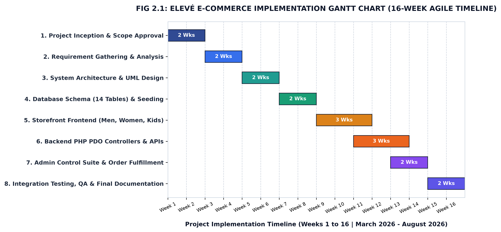
*Figure 2.1: Project Implementation Gantt Chart (16-Week Agile Timeline)*

---

# 3. REQUIREMENT DETERMINATION & ANALYSIS

### 3.1 Requirement Determination Methodology
Requirements were gathered using a hybrid approach combining competitive analysis of high-end fashion portals (such as Zara and SSENSE) with stakeholder interviews conducted under the guidance of Dr. Anjum Y. Mansuri.

### 3.2 Functional Requirements
- **FR-01 (Catalog Browsing):** The platform shall provide dedicated storefronts for Men (`men.html`), Women (`women.html`), and Kids (`kids.html`), with 29 verified items and no footwear.
- **FR-02 (Live Search):** A live search modal shall filter products in real time by name, category, and tags, rendering matching product cards with prices.
- **FR-03 (Product Customization):** The product detail view shall support dynamic color swatches, size selection (S, M, L, XL, XXL), quantity steppers, and accordion specifications.
- **FR-04 (Cart & Wishlist):** Off-canvas drawers shall maintain shopping cart and wishlist items using LocalStorage with instant DOM synchronization.
- **FR-05 (Checkout & Orders):** The checkout pipeline shall collect shipping details, calculate tax and delivery charges, and execute multi-item database orders.
- **FR-06 (User Authentication):** The system shall support customer authentication (registration/login) as well as guest checkout workflows.
- **FR-07 (Admin Management):** The admin panel (`admin/orders.php`) shall display customer names, allow order status updates, and support single-click order deletion.

### 3.3 Non-Functional Requirements
- **NFR-01 (Performance):** All pages shall load in under 1.5 seconds on standard broadband connections. Product filtering operations shall complete within 100 milliseconds.
- **NFR-02 (Security):** All database queries shall use PDO prepared statements to eliminate SQL injection vulnerabilities. Customer passwords shall be hashed using Bcrypt.
- **NFR-03 (Responsiveness):** The layout shall render responsively across mobile, tablet, and desktop viewports (320px to 2560px) using flexible CSS grid systems.
- **NFR-04 (Reliability):** The backend database shall use the InnoDB engine to guarantee ACID transaction properties during concurrent order placements.

---

# 4. SYSTEM DESIGN

### 4.1 System Architecture Diagram
ELEVÉ follows a decoupled 3-tier web architecture comprising the Client Presentation Layer, the Application / Web Server Layer, and the Relational Database Layer:

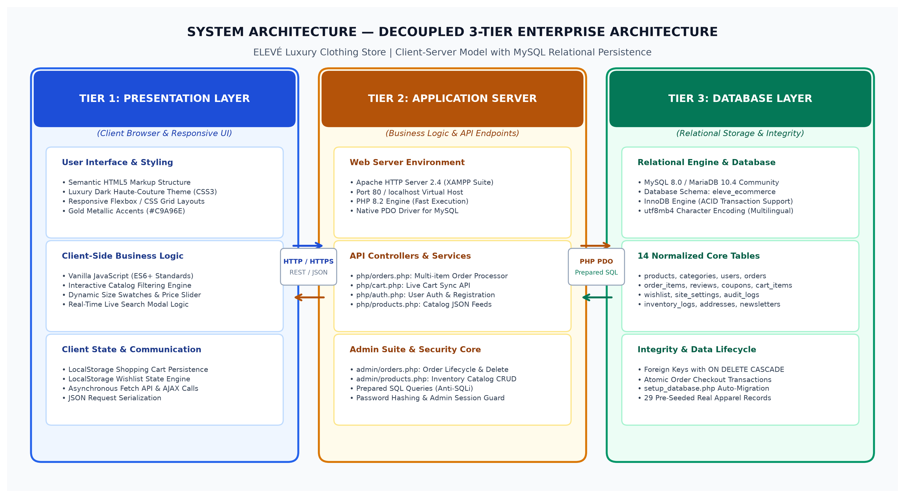
*Figure 4.1: Decoupled 3-Tier Enterprise Architecture — ELEVÉ Platform*

- **Tier 1 — Presentation Layer (Browser Client):** Comprises responsive semantic HTML5 structure, custom Haute-Couture dark styling (CSS3) with luxury gold accents (`#C9A96E`), and Vanilla JavaScript (ES6+). State management for shopping cart and wishlist is handled via LocalStorage with real-time DOM synchronization. Shopper interactions dispatch asynchronous HTTP/HTTPS fetch requests with serialized JSON payloads.
- **Tier 2 — Application / Server Layer (Apache & PHP):** Hosted on an Apache HTTP 2.4 server within the XAMPP stack. The backend is powered by PHP 8.2 delivering RESTful API endpoints (`php/orders.php`, `php/cart.php`, `php/auth.php`, `php/products.php`) and the comprehensive administrative control suite (`admin/*.php`). The server layer enforces strict session security, parameter validation, role-based access control, and executes atomic business logic.
- **Tier 3 — Relational Persistence Layer (MySQL / MariaDB):** Powered by an ACID-compliant MySQL 8.0 InnoDB storage engine under the `eleve_ecommerce` schema. The database is fully normalized across 14 relational tables with InnoDB foreign key constraints and cascading integrity. The database was populated using an automated seed migration script with 29 real apparel products strictly spanning Men, Women, and Kids.

### 4.2 Use Case Diagram & Actor Descriptions
The Use Case diagram visualizes the behavioral interactions between the two primary system actors (Customer and Store Admin) and the core platform functionalities:

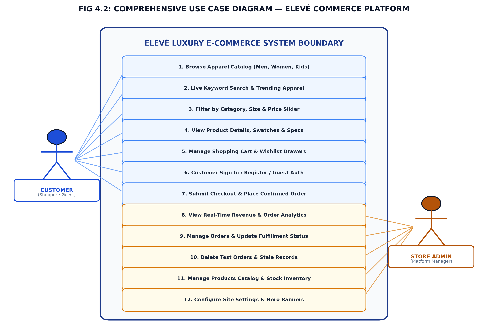
*Figure 4.2: Comprehensive Use Case Diagram — Customer & Admin Interactions*

### 4.3 Class Diagram & Domain Entities
- **User Entity:** `id`, `name`, `email`, `password`, `phone`, `address`, `role`, `is_active`. Methods: `register()`, `login()`, `logout()`, `updateProfile()`.
- **Product Entity:** `id`, `name`, `category`, `subcategory`, `gender`, `price`, `old_price`, `stock_qty`, `rating`. Methods: `getDetails()`, `updateStock()`, `calculateDiscount()`.
- **Order Entity:** `id`, `order_number`, `user_id`, `status`, `payment_status`, `total`, `shipping_name`, `shipping_address`. Methods: `placeOrder()`, `updateStatus()`, `deleteOrder()`, `calculateTax()`.
- **OrderItem Entity:** `id`, `order_id`, `product_id`, `product_name`, `size`, `color`, `qty`, `price`, `total`. Methods: `calculateLineTotal()`.
- **Coupon Entity:** `id`, `code`, `type`, `value`, `min_order`, `is_active`. Methods: `validate()`, `applyDiscount()`.

### 4.4 Interaction / Sequence Diagram
1. **Step 1 (Checkout Dispatch):** Shopper submits shipping address and selects payment method on `checkout.html`.
2. **Step 2 (API Handshake):** `checkout.html` sends an asynchronous POST request with FormData and cart line items to `php/orders.php`.
3. **Step 3 (Atomic Insertion):** `php/orders.php` opens a database transaction, inserts master record into `orders` table, and batch-inserts line items into `order_items`.
4. **Step 4 (Receipt Generation):** Database commits transaction; `php/orders.php` returns JSON confirmation with unique order number (e.g. `ELV-2026-1006`).
5. **Step 5 (Admin Processing):** Store Administrator accesses `admin/orders.php` to review customer name, shipping destination, order total, and update status to 'Shipped' or 'Delivered'.

### 4.5 Activity Diagram (Order Placement Pipeline)
The Activity Diagram models the dynamic operational workflow of the end-to-end purchasing process, tracing the shopper journey from initial collection exploration through checkout validation, atomic database persistence, and administrative fulfillment:

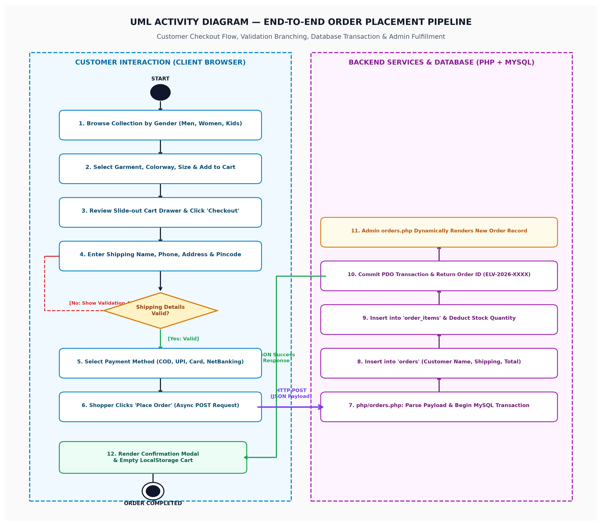
*Figure 4.5: UML Activity Diagram — End-to-End Order Placement Pipeline & Multi-Tier Transaction Flow*

- **Stage 1 (Catalog Browsing):** Shopper navigates the storefront via category navigation pills (Men, Women, Kids) or the curated seasonal feature banners.
- **Stage 2 (Garment Selection):** Shopper explores filtered garments, inspects product photography, examines size charts, and selects dynamic colorway swatches and sizes (XS to XXL).
- **Stage 3 (Cart Drawer Integration):** Shopper clicks 'Add to Cart', triggering immediate LocalStorage serialization and sliding open the off-canvas shopping drawer with line-item totals.
- **Stage 4 (Shipping Details Capture):** Shopper clicks 'Proceed to Checkout', navigating to `checkout.html` where shipping credentials (Full Name, Phone, Email, Street Address, City, State, PIN) are entered.
- **Stage 5 (Form Validation Branching):** Client-side JavaScript inspects mandatory input fields. If any required field or phone number format is invalid, an alert is rendered and execution halts until resolved.
- **Stage 6 (Payment Method Selection):** Shopper chooses from supported payment methods: Cash on Delivery (COD), UPI (GPay/PhonePe/Paytm), Credit/Debit Card, or Net Banking.
- **Stage 7 (Async API Dispatch):** Shopper confirms order; `checkout.js` dispatches an asynchronous HTTP POST request containing order metadata and line items to `php/orders.php`.
- **Stage 8 (Transaction Initiation):** `php/orders.php` receives payload, verifies user session or guest data, and opens a MySQL database transaction (`$pdo->beginTransaction()`).
- **Stage 9 (Master Order Persistence):** A master record is inserted into the `orders` table containing order number (`ELV-2026-XXXX`), customer full name, contact, address, total sum, and `status='Confirmed'`.
- **Stage 10 (Item Insertion & Stock Deduction):** Each cart item is iterated and inserted into `order_items`. Simultaneously, an atomic UPDATE query decrements available `stock_qty` in the `products` table.
- **Stage 11 (Transaction Commit & Receipt):** The transaction commits successfully (`$pdo->commit()`). The server returns a 200 OK JSON response containing the generated order tracking number.
- **Stage 12 (Order Lifecycle & Admin Fulfillment):** The client UI displays a modal order confirmation, empties the shopping cart, and the new order immediately surfaces in `admin/orders.php` for processing.

### 4.6 Comprehensive Data Dictionary (14 Relational Tables)

#### Table 1: `users` (User Accounts & Administrators)
| Column Name | Data Type | Constraints | Description | Sample Value |
|---|---|---|---|---|
| `id` | INT | PRIMARY KEY, AUTO_INCREMENT | Unique user identifier | `1` |
| `name` | VARCHAR(100) | NOT NULL | Full customer or admin name | `Admin / Rahul Sharma` |
| `email` | VARCHAR(150) | UNIQUE, NOT NULL | Login email address | `admin@gmail.com` |
| `password` | VARCHAR(255) | NOT NULL | Bcrypt cryptographic password hash | `$2y$12$NdjdsGvv7T...` |
| `phone` | VARCHAR(20) | NULL | Contact phone number | `+91 98251 12345` |
| `address` | TEXT | NULL | Default residential delivery address | `A-402, Titanium City` |
| `role` | ENUM('user','admin') | DEFAULT 'user' | Access control authority | `admin` |
| `is_active` | TINYINT(1) | DEFAULT 1 | Account enablement flag | `1` |
| `created_at` | TIMESTAMP | DEFAULT CURRENT_TIMESTAMP | Record creation timestamp | `2026-11-20 10:00:00` |

#### Table 2: `categories` (Apparel Departments)
| Column Name | Data Type | Constraints | Description | Sample Value |
|---|---|---|---|---|
| `id` | INT | PRIMARY KEY, AUTO_INCREMENT | Unique category identifier | `1` |
| `name` | VARCHAR(100) | NOT NULL | Department display title | `Men's T-Shirts` |
| `slug` | VARCHAR(100) | UNIQUE, NOT NULL | URL identifier | `men-tshirts` |
| `gender` | ENUM('men','women','kids') | NOT NULL | Department target group | `men` |
| `image_url` | VARCHAR(500) | NULL | Category thumbnail image path | `images/men/tshirt-1.jpg` |
| `is_active` | TINYINT(1) | DEFAULT 1 | Display toggle | `1` |
| `sort_order` | INT | DEFAULT 0 | Navigation sorting priority | `1` |

#### Table 3: `products` (29 Verified Apparel Products)
| Column Name | Data Type | Constraints | Description | Sample Value |
|---|---|---|---|---|
| `id` | INT | PRIMARY KEY, AUTO_INCREMENT | Unique product identifier | `1` |
| `name` | VARCHAR(200) | NOT NULL | Garment commercial title | `Men's Noir Graphic Tee` |
| `category` | VARCHAR(100) | NOT NULL | Primary apparel type | `T-Shirts` |
| `subcategory` | VARCHAR(100) | NULL | Subcategory classification | `t-shirts` |
| `gender` | ENUM('men','women','kids') | NOT NULL | Target demographic | `men` |
| `price` | DECIMAL(10,2) | NOT NULL | Selling price in INR (₹) | `699.00` |
| `old_price` | DECIMAL(10,2) | NULL | Original price for strikethrough | `899.00` |
| `badge` | VARCHAR(50) | NULL | Merchandising badge label | `Best Seller` |
| `rating` | DECIMAL(3,2) | DEFAULT 4.50 | Average customer rating | `4.80` |
| `stock_qty` | INT | DEFAULT 100 | Available inventory stock | `85` |
| `description` | TEXT | NULL | Marketing narrative | `Signature streetwear...` |
| `fit` | TEXT | NULL | Fit specification | `Regular streetwear fit` |
| `details` | TEXT | NULL | Pipe-separated fabric specs | `100% cotton|220GSM` |
| `is_active` | TINYINT(1) | DEFAULT 1 | Catalog display toggle | `1` |

#### Table 4: `orders` (Customer Transactions Registry)
| Column Name | Data Type | Constraints | Description | Sample Value |
|---|---|---|---|---|
| `id` | INT | PRIMARY KEY, AUTO_INCREMENT | Unique order ID | `1` |
| `order_number` | VARCHAR(20) | UNIQUE, NOT NULL | Public order tracking serial | `ELV-2026-1001` |
| `user_id` | INT | FOREIGN KEY (users.id) NULL | Associated account ID if logged in | `NULL` |
| `status` | ENUM(...) | DEFAULT 'pending' | Fulfillment lifecycle state | `delivered` |
| `payment_status` | ENUM(...) | DEFAULT 'pending' | Payment settlement status | `paid` |
| `payment_method` | VARCHAR(50) | DEFAULT 'cod' | Payment method used | `card / upi / cod` |
| `subtotal` | DECIMAL(10,2) | NOT NULL | Sum before discount | `2098.00` |
| `discount` | DECIMAL(10,2) | DEFAULT 0.00 | Promo deduction in ₹ | `200.00` |
| `total` | DECIMAL(10,2) | NOT NULL | Net payable total in ₹ | `1898.00` |
| `shipping_name` | VARCHAR(150) | NOT NULL | Customer recipient name | `Rahul Sharma` |
| `shipping_email` | VARCHAR(150) | NOT NULL | Notification email | `rahul.sharma@example.com` |
| `shipping_phone` | VARCHAR(20) | NOT NULL | Contact phone number | `+91 98251 12345` |
| `shipping_address` | TEXT | NOT NULL | Street delivery address | `A-402, Titanium City` |
| `shipping_city` | VARCHAR(100) | NOT NULL | Destination city | `Ahmedabad` |
| `shipping_pincode` | VARCHAR(10) | NOT NULL | Postal PIN code | `380015` |
| `created_at` | TIMESTAMP | DEFAULT CURRENT_TIMESTAMP | Order submission time | `2026-11-20 10:15:00` |

#### Table 5: `order_items` (Order Line Items)
| Column Name | Data Type | Constraints | Description | Sample Value |
|---|---|---|---|---|
| `id` | INT | PRIMARY KEY, AUTO_INCREMENT | Line item identifier | `1` |
| `order_id` | INT | FOREIGN KEY (orders.id) CASCADE | Parent order reference | `1` |
| `product_id` | INT | FOREIGN KEY (products.id) | Garment reference | `1` |
| `product_name` | VARCHAR(200) | NOT NULL | Snapshot of garment name | `Men's Noir Graphic Tee` |
| `product_image` | VARCHAR(500) | NULL | Snapshot of thumbnail path | `images/men/tshirt-1.jpg` |
| `size` | VARCHAR(20) | NOT NULL | Selected garment size | `L` |
| `color` | VARCHAR(50) | NULL | Selected garment color | `Black` |
| `qty` | INT | NOT NULL | Quantity purchased | `1` |
| `price` | DECIMAL(10,2) | NOT NULL | Unit price in ₹ | `699.00` |
| `total` | DECIMAL(10,2) | NOT NULL | Line total (price × qty) | `699.00` |

#### Tables 6 to 14: Auxiliary Platform Data Stores
| Table Name | Key Column Attributes | Primary Constraints | Functional Purpose |
|---|---|---|---|
| `product_images` | `id, product_id, url, sort_order` | `FOREIGN KEY (products.id)` | Multi-angle garment photography paths |
| `product_sizes` | `id, product_id, size` | `FOREIGN KEY (products.id)` | Garment size options (S, M, L, XL, 32, 7-8Y) |
| `product_colors` | `id, product_id, name, hex` | `FOREIGN KEY (products.id)` | Garment color swatches and hex values (`#1a1a1a`) |
| `cart_items` | `id, session_id, user_id, product_id, qty` | `FOREIGN KEY (products.id)` | Server-side session shopping cart data |
| `wishlist_items` | `id, session_id, user_id, product_id` | `FOREIGN KEY (products.id)` | Bookmarked customer favorites across visits |
| `coupons` | `id, code, type, value, min_order, is_active` | `UNIQUE(code)` | Promo discount codes (WELCOME10, FLAT200, SAVE15) |
| `reviews` | `id, product_id, name, rating, comment, is_approved` | `FOREIGN KEY (products.id)` | Customer product reviews and star ratings (1 to 5) |
| `newsletter_subscribers` | `id, email, is_active, subscribed_at` | `UNIQUE(email)` | Email subscriptions for fashion releases |
| `contact_messages` | `id, name, email, subject, message, status` | `ENUM(...)` | Customer support inquiries from contact page |
| `settings` | `id, setting_key, setting_value` | `UNIQUE(setting_key)` | Global config parameters (`site_name`, `free_shipping_min`) |

---

# 5. DEVELOPMENT & IMPLEMENTATION

### 5.1 Development Approach (Agile Methodology)
The team implemented an iterative Agile Scrum methodology structured into 2-week sprint cycles. Daily stand-ups allowed team members to coordinate UI component styling, database migration scripts, and REST controller endpoints.

### 5.2 Coding Standards & Architectural Best Practices
- **Naming Conventions:** Classes use PascalCase (`OrderController`), JS functions use camelCase (`placeOrder`), constants use UPPER_CASE (`SITE_URL`), database tables use lowercase snake_case (`order_items`).
- **Frontend Standards:** Strict adherence to HTML5 semantic tags (`<header>`, `<main>`, `<section>`, `<article>`, `<aside>`, `<footer>`) for accessibility and SEO.
- **Backend Security:** All database queries execute through PHP Data Objects (PDO) with parameterized prepared statements, completely mitigating SQL Injection risks.
- **Input Sanitization:** All dynamic user inputs rendered onto HTML views pass through `htmlspecialchars()` with UTF-8 encoding.

### 5.3 GitHub Repository Details & Version Control Structure
- **Repository URL:** `https://github.com/jaimisha15/Eleve-clothing-ecommerce`
- **Branch:** `main`

### 5.4 AI Tools, Libraries and APIs Used
- **Google Antigravity:** Advanced agentic coding assistant used for automated codebase refactoring, terminal orchestration, script generation, and integration testing.
- **ChatGPT (OpenAI):** Employed for drafting luxury brand copywriting, product narrative descriptions, and edge-case testing scripts.
- **PHP Data Objects (PDO):** Built-in native PHP database abstraction layer providing robust, prepared statement database transactions.
- **Modern Fetch API:** Asynchronous JavaScript API used for frictionless order submission and background cart synchronization without page reloads.
- **Google Fonts (Inter & Playfair):** Editorial web fonts providing the modern luxury visual identity across storefront and admin views.

---

### 5.5 Implementation Walkthrough & Live System Screenshots

#### Suite A: Storefront Discovery & Visual Merchandising

##### Screen 5.1: Storefront Landing Page & Header Navigation
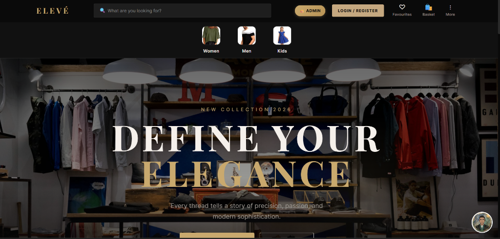
*Figure 5.1: Storefront Landing Page — Dedicated '👑 ADMIN' Header Control, Category Carousel & Brand Identity*
- Features the brand logo, live search input bar, dedicated customer LOGIN / REGISTER button, and a separate gold Admin button. The visual category bar sits directly below with thumbnails for Women, Men, and Kids.
- Strict architectural separation ensures customer authentication and administrative store governance remain cleanly isolated in the navigation bar.

##### Screen 5.2: Curated Women's Feature Banner

*Figure 5.2: Women's Collection Feature Showcase — Editorial Visual Merchandising Banner*
- Presents a high-impact promotional billboard for the curated Women's collection with a call-to-action button linking directly to the filtered department catalog.
- Incorporates responsive multi-resolution image sources and CSS gradient overlays to maintain high readability across desktop and mobile screens.

##### Screen 5.3: Storefront Trust Propositions & Gender Navigation

*Figure 5.3: Storefront Trust Propositions & Curated Gender Navigation Bar*
- Communicates store guarantees: Free Shipping over ₹999, Premium Handcrafted Quality, 30-Day Easy Returns, and 100% Encrypted Checkout.
- Includes a persistent announcement bar and smooth scroll anchor points leading into the curated department catalog sections.

##### Screen 5.4: Interactive Live Search Modal

*Figure 5.4: Live Dynamic Search Overlay with Real-Time Trending Suggestions & Product Cards*
- Instantly triggered via the search icon or keyboard input, presenting popular trending picks with image thumbnails, categories, and discounted prices.
- Executes debounced client-side filtering over the pre-indexed catalog array, delivering instantaneous search responses without server roundtrips.

---

#### Suite B: Catalog Filtering, Product Customization & Shopper Engagement

##### Screen 5.5: Multi-Faceted Apparel Catalog & Sidebar Filters

*Figure 5.5: Complete Apparel Catalog with Multi-Facet Filtering (Collections, Sizes & Sorting)*
- Enables multi-facet filtration by Collections (New Arrivals, Best Sellers, Sale), Sizes (XS to XL), and Price sorting (Low-to-High / High-to-Low).
- Dynamic DOM manipulation refreshes product cards with smooth CSS transitions without requiring a full browser page reload.

##### Screen 5.6: Category Catalog with Interactive Price Range Slider

*Figure 5.6: Women's Department Catalog with Dynamic Price Slider (₹0 – ₹4,000) & Gender Facets*
- Features an interactive HTML5 dual range slider allowing shoppers to set minimum and maximum price thresholds in real time.
- Garment count badges update dynamically, showing exactly how many luxury items match the active budget criteria.

##### Screen 5.7: Product Quick-View, Color Swatches & Wishlist Drawer
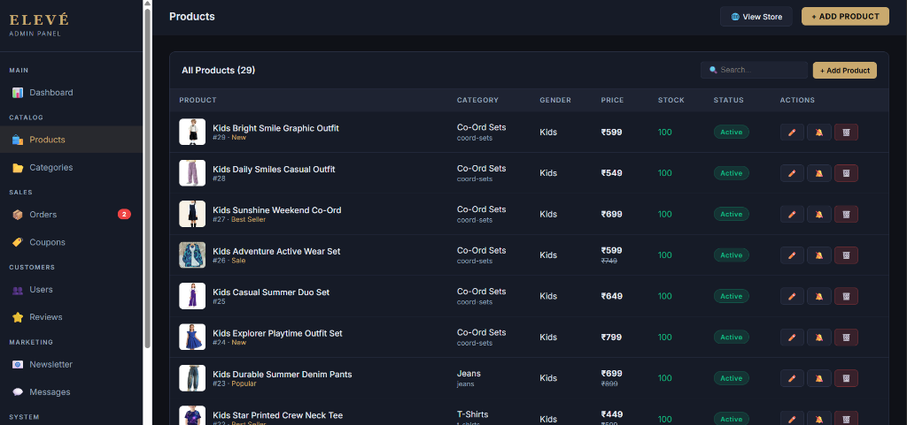
*Figure 5.7: Product Detail Quick-View with Color Swatches, Size Matrix & Slide-Out Wishlist Drawer*
- Displays high-resolution garment imagery, interactive color swatches (Black, White, Navy), size selectors (S to XXL), and quantity steppers.
- The right slide-out Wishlist drawer enables instant bookmarking and single-click item removal with LocalStorage persistence.

##### Screen 5.8: Off-Canvas Shopping Cart Drawer
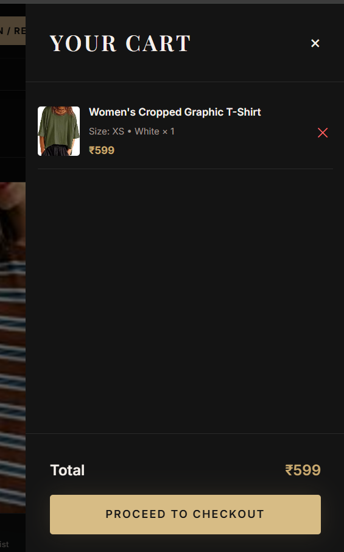
*Figure 5.8: Sliding Cart Drawer with Real-Time Subtotal Calculation & Checkout Gateway*
- The off-canvas shopping cart drawer displays selected garments with thumbnail, size, color, quantity, and unit price in Indian Rupees.
- Line-item subtotals update instantaneously. The 'PROCEED TO CHECKOUT' button navigates directly to the validated checkout pipeline.

---

#### Suite C: Customer Authentication & Secure Checkout Pipeline

##### Screen 5.9: Customer Authentication & Guest Access Modal
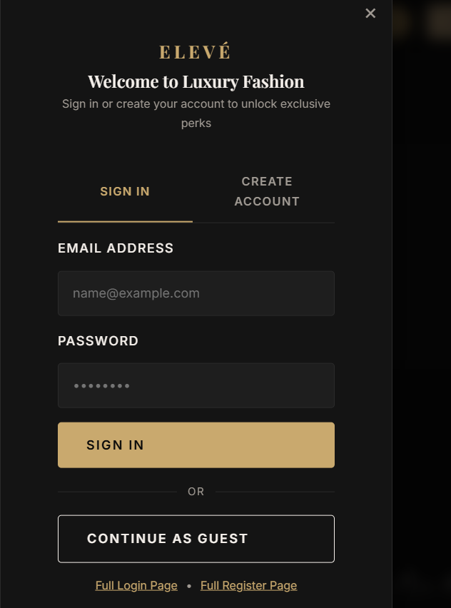
*Figure 5.9: Luxury Customer Sign-In / Account Creation Modal with Instant Guest Checkout*
- Provides tabbed customer authentication for Sign In and Account Creation with Bcrypt password verification.
- Includes a 'CONTINUE AS GUEST' escape hatch, eliminating mandatory registration friction and drastically reducing checkout drop-off rates.

##### Screen 5.10: Two-Column Checkout Interface — Customer Shipping Information
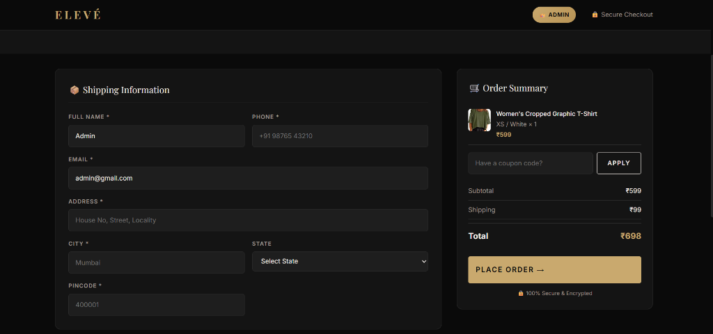
*Figure 5.10: Checkout Stage 1 — Customer Shipping Destination & Order Summary Breakdown*
- Presents a structured two-column layout: shipping address form on the left, order line items and financial breakdown on the right.
- Calculates subtotal (₹599) plus standard shipping (₹99) to produce net payable total (₹698), with coupon redemption support.

##### Screen 5.11: Multi-Gateway Payment Selection & Encrypted Submission
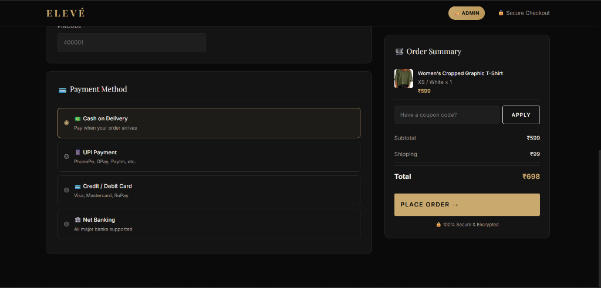
*Figure 5.11: Checkout Stage 2 — Payment Gateway Options (COD, UPI, Card, Net Banking)*
- Offers four distinct payment channels: Cash on Delivery (COD), UPI Payment (PhonePe, GPay, Paytm), Credit/Debit Card, and Net Banking.
- Clicking 'PLACE ORDER' initiates an asynchronous POST request to `php/orders.php`, executing an atomic transaction in MySQL.

---

#### Suite D: Administrative Operations & Store Governance Suite

##### Screen 5.12: Admin Control Center — Executive Analytics Dashboard
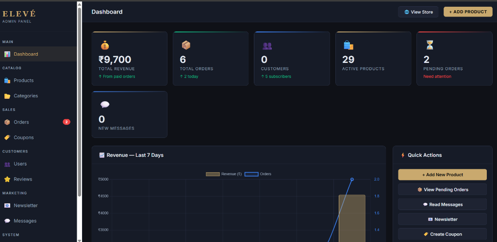
*Figure 5.12: Admin Analytics Dashboard — Real-Time KPI Metrics, 7-Day Revenue Trend & Quick Actions*
- Surfaces four primary KPI tiles: Total Revenue (₹9,700), Total Orders (6), Active Products (29), and Pending Orders (2).
- Displays a 7-day revenue trend bar chart and quick-action shortcuts for rapid inventory and catalog management.

##### Screen 5.13: Catalog Management — Complete 29-Apparel Product Registry
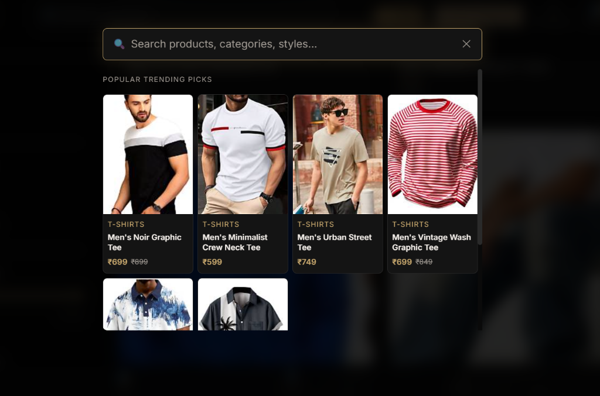
*Figure 5.13: Admin Products Management — Complete 29-Garment Inventory Table with Action Controls*
- Tabulates all 29 active clothing items across Men, Women, and Kids with visual thumbnails, category badges, pricing, stock levels, and status indicators.
- Provides action triggers for Edit, Low-Stock Alert, and Delete, with instant modal confirmations for inventory modifications.

##### Screen 5.14: Taxonomy Architecture — Category & Slug Manager
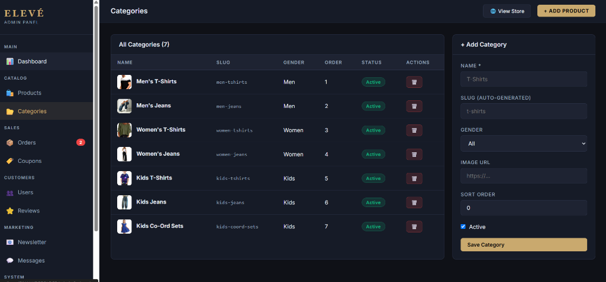
*Figure 5.14: Admin Category Manager — Dynamic Taxonomy Slugs, Sort Orders & Creation Form*
- Manages category taxonomies (Men's T-Shirts, Men's Jeans, Women's T-Shirts, Women's Jeans, Kids' T-Shirts, etc.) with URL slugs and sort priorities.
- Includes an inline '+ Add Category' form allowing instant creation of new apparel departments without code alterations.

##### Screen 5.15: Storefront Configuration — Site Settings & Credentials
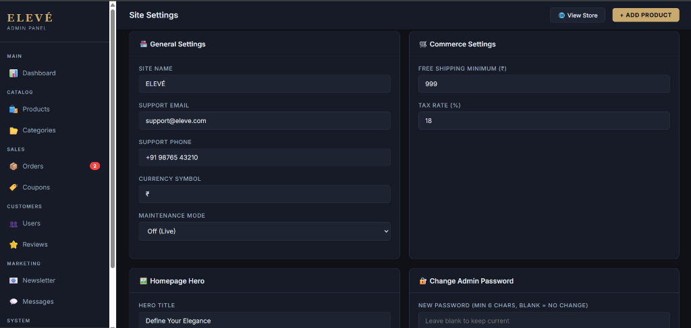
*Figure 5.15: Admin Site Settings — General Store Config, Commerce Economics & Hero Customizer*
- Configures global platform parameters: Store Name, Support Email, Contact Phone, Currency (₹ INR), Tax Rates, and Free Shipping Thresholds.
- Enables dynamic customization of the landing page Hero Title and Subtitle, as well as administrative credential password updates.

---

# 6. PROPOSED ENHANCEMENTS
While ELEVÉ delivers a fully operational e-commerce platform, the following architectural enhancements are planned for future production versions:
1. **Live Payment Gateway Integration:** Integrate Razorpay and Stripe merchant webhooks for automated UPI QR code scanning and instant payment callbacks.
2. **AI-Powered Virtual Style Advisor:** Implement an embedded machine-learning chatbot capable of recommending garment sizes based on height/weight and suggesting matching apparel sets.
3. **Automated Logistics Tracking:** Connect backend order dispatches to courier APIs (Shiprocket / Delhivery) to generate live airway bill (AWB) tracking numbers automatically.
4. **Progressive Web App (PWA):** Register service workers and offline caching manifests enabling shoppers to install ELEVÉ directly onto Android and iOS home screens as a native app.
5. **Multi-Currency & Internationalization:** Support real-time currency conversion (USD, EUR, GBP, AED) with multi-language locale switching for global luxury distribution.

---

# 7. CONCLUSION
The ELEVÉ clothing store e-commerce project successfully demonstrates the comprehensive design, engineering, and deployment of a full-stack digital commerce platform tailored to the luxury apparel industry. Over the course of the project lifecycle, our team achieved the following deliverables:
- **Focused Apparel Merchandising:** Curated an exclusive inventory of 29 real apparel items strictly spanning Men, Women, and Kids, with all footwear purged.
- **Robust Full-Stack Pipeline:** Integrated semantic frontend interfaces with secure PHP PDO prepared statement controllers and a normalized 14-table MySQL database.
- **Unified Store Governance:** Constructed an administrative suite capable of real-time sales reporting, lifecycle order status transitions, and data governance.
- **Academic Rigor & Teamwork:** Applied real-world software engineering concepts including Git version management, transaction atomicity, and parameterized SQL security.

The completed application satisfies all curriculum benchmarks for the Master of Computer Applications (Integrated) program at Lok Jagruti Kendra University (LJKU).

---

# 8. BIBLIOGRAPHY & REFERENCES
- **[1] W3C Standards:** World Wide Web Consortium, "HTML5 & CSS3 Recommendation Standards", https://www.w3.org/TR/html52/
- **[2] MDN Web Docs:** Mozilla Developer Network, "JavaScript ES6+ Language Specification & DOM API Documentation", https://developer.mozilla.org/
- **[3] The PHP Group:** The PHP Group, "PHP 8.x PDO Manual & Prepared Statement Security", https://www.php.net/manual/en/book.pdo.php
- **[4] Oracle Corporation:** Oracle Corporation, "MySQL 8.0 Reference Manual: Relational Schema Design & InnoDB Foreign Key Optimization", https://dev.mysql.com/doc/
- **[5] Martin, Robert C.:** Martin, Robert C., "Clean Code: A Handbook of Agile Software Craftsmanship", Prentice Hall, 2008.
- **[6] Academic Guidance:** Project completed under the guidance of Dr. Anjum Y. Mansuri, Assistant Professor, Computer Applications, LJ Institute of Computer Applications, LJ University, Ahmedabad. GitHub: `@anjum-mansuri`.
